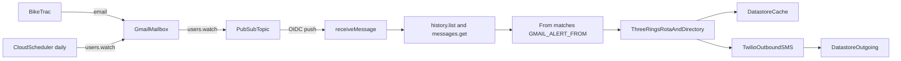

# Architecture

## Summary

Beeper is three Gen2 HTTP Cloud Functions (`receiveMessage`, `renewGmailWatch`, and `threeRingsHotCache`) sharing one deploy artifact. `receiveMessage` accepts a Gmail Pub/Sub push, resolves who is on call from Three Rings, and forwards the email’s plain-text body via Twilio SMS. `renewGmailWatch` is invoked daily by Cloud Scheduler so the Gmail mailbox watch does not expire. `threeRingsHotCache` is invoked hourly by Cloud Scheduler to warm the Three Rings rota cache. Datastore stores an audit log of inbound/outbound messages, the Gmail history cursor, and cached Three Rings API responses.

## Components

| Component | Responsibility | Location |
|-----------|----------------|----------|
| Alert handler | Orchestrate decode → fetch mail → log → lookup → SMS | [`src/functions/receiveMessage.ts`](../../src/functions/receiveMessage.ts) |
| Gmail watch | Call `users.watch` and store the first history cursor | [`src/functions/renewGmailWatch.ts`](../../src/functions/renewGmailWatch.ts) |
| Hot cache handler | Warm Three Rings rota cache on schedule | [`src/functions/threeRingsHotCache.ts`](../../src/functions/threeRingsHotCache.ts) |
| Gmail client | OAuth refresh token, history, plain text | [`src/gmail/`](../../src/gmail/) |
| Sign-in script | One-time browser consent for the watched mailbox | [`scripts/authorize-gmail.ts`](../../scripts/authorize-gmail.ts) |
| Cloud Scheduler | Hourly rota cache warm; daily Gmail watch renewal | [`infrastructure/main.tf`](../../infrastructure/main.tf) |
| Config | Env vars and `ENABLE_CONTROLLER_ALERTS` | [`src/config/index.ts`](../../src/config/index.ts) |
| Three Rings HTTP repo | Live rota + directory fetches | [`src/repository/ThreeRingsHttpRepository.ts`](../../src/repository/ThreeRingsHttpRepository.ts) |
| Caching repo | Datastore-backed cache decorator | [`src/repository/ThreeRingsCachingRepository.ts`](../../src/repository/ThreeRingsCachingRepository.ts) |
| Three Rings service | Shift matching, phone extraction | [`src/service/three-rings.ts`](../../src/service/three-rings.ts) |
| Message log | Incoming / outgoing Datastore entities | [`src/service/message-log.service.ts`](../../src/service/message-log.service.ts) |
| Logging | Structured logs (pino) | [`src/service/logging.service.ts`](../../src/service/logging.service.ts) |
| Terraform stack | Functions, Pub/Sub, secrets, IAM, Datastore, GCS | [`infrastructure/`](../../infrastructure/) |

## Data / control flow

Happy path:

1. Gmail POSTs a Pub/Sub push envelope to `receiveMessage`. `message.data` decodes to `emailAddress` and `historyId` only.
2. Notifications for any address other than `GMAIL_WATCH_USER` are acknowledged and ignored.
3. If the `historyId` is newer than the `GmailSync` cursor, messages added to `INBOX` are loaded with `users.history.list` and `users.messages.get`. Drafts, sent mail, and spam are not read.
4. Messages whose From address matches `GMAIL_ALERT_FROM` and which have a plain-text body are logged as Datastore kind `IncomingRequest` (key: Gmail message id). The SMS is the event description, from "A new Event has been created" up to the location line. Map links and the theft-confirmation footer are dropped. If that template is missing, the whole plain-text body is texted with links removed, and a warning is logged.
5. Three Rings rota for today is loaded (cached); shifts of type `Controller` and `Duty Trustee` containing “now” are selected.
6. Each volunteer’s directory entry is loaded (cached); `TelProperty` phones are normalized (`07…` → `+44…`).
7. Outbound SMS is sent with sender ID `BBWales` and the extracted event text. Controllers are included only when `ENABLE_CONTROLLER_ALERTS=true`.
8. Outbound rows are stored as child `OutgoingMessage` entities. The history cursor advances. The response is **204**.

**Watch path:** Cloud Scheduler POSTs to `renewGmailWatch` daily → `users.watch` on `INBOX` for the refresh-token mailbox → if `GmailSync` has no cursor yet, the watch `historyId` is stored. Later renewals do not move the cursor backwards. A watch expires after 7 days if this job stops.

**Hot cache path:** Cloud Scheduler POSTs to `threeRingsHotCache` hourly → fetches today’s rota from Three Rings → writes `ThreeRingsCache` in Datastore so `receiveMessage` can use a warm cache.

## Key modules

See the component table above. Types for alerts and Three Rings payloads live under [`src/types/`](../../src/types/). Shared helpers (time, phone redaction) are in [`src/utility.ts`](../../src/utility.ts). Datastore client setup is in [`src/datastore.ts`](../../src/datastore.ts).

## Persistence and caching

| Kind | Purpose |
|------|---------|
| `IncomingRequest` | Audit log of an inbound alert email (28-day TTL) |
| `OutgoingMessage` | Child entities for forwarded SMS (28-day TTL) |
| `GmailSync` | Last processed Gmail `historyId` for a mailbox |
| `ThreeRingsCache` | Cached rota (`rota-{YYYY-MM-DD}`) and volunteer (`volunteer-{id}`) JSON |

Database ID in GCP: `beeper-database` (Datastore mode). Local emulator project: `beeper-local`. Message logs (`IncomingRequest`, `OutgoingMessage`) expire after **28 days**. Three Rings cache (`rota-{YYYY-MM-DD}` and `volunteer-{id}`) expires after **24 hours** (`expiresAt`). Cloud Function logs in Cloud Logging (`_Default`) are retained for **28 days**.

## Integrations

| System | Direction | Purpose |
|--------|-----------|---------|
| BikeTrac | Inbound email | Originates bike alert messages |
| Gmail | In | Mailbox watch, history, and message read |
| Cloud Pub/Sub | In | Delivers Gmail push notifications to `receiveMessage` |
| Twilio | Out | Outbound SMS |
| Three Rings | Outbound HTTP | Rota and volunteer directory / phone |
| GCP Secret Manager | In | API keys, Gmail OAuth secret, refresh token, Twilio credentials |
| GCP Datastore | Read/write | Message log, Gmail cursor, and Three Rings cache |
| GCP Cloud Logging | Outbound (function stdout) | Application logs; `_Default` bucket retained 28 days |

## Failure modes

- Pub/Sub push from any principal other than the push service account is rejected by Cloud Run IAM. The function is not public.
- Malformed push bodies are acknowledged so they are not retried forever.
- A Gmail, Three Rings, or Twilio failure returns **500** so Pub/Sub retries. An alert already logged is not sent again. A failed send deletes its claim so the retry can send it.
- A history cursor that Gmail no longer recognises falls back to a short recent search for `GMAIL_ALERT_FROM`.
- Missing or ambiguous on-call shifts (not exactly one of each role) → handler errors in Three Rings service logic.
- Missing telephone property on a volunteer → cannot forward to that person.
- Feature flag off → Controller is skipped even if on shift (current Terraform default).
- Shared staging stack → last PR deploy wins.
- OAuth consent screen left in Testing → refresh token expires after 7 days and pushes stop.
- Watch not renewed within 7 days → Gmail stops publishing.
