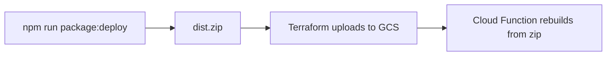

# beeper

A Google Cloud Function that receives BikeTrac alert emails through Gmail push notifications, looks up the on-call volunteers from [Three Rings](https://www.3r.org.uk), and forwards the alert to the current Controller and Duty Trustee by SMS.

## How it works

1. BikeTrac sends an email to a Workspace mailbox when a tracked bike triggers an event (e.g. theft detection).
2. Gmail publishes a mailbox change to a Pub/Sub topic. The push subscription POSTs that notification to the `receiveMessage` Cloud Function.
3. The function loads new mail since its stored history cursor and keeps messages whose From address matches `GMAIL_ALERT_FROM`.
4. The inbound alert is logged to Cloud Datastore.
5. The function queries the Three Rings rota to find who is on shift right now as **Controller** and **Duty Trustee** (responses are cached in Datastore).
6. It fetches each volunteer's phone number from the Three Rings directory (also cached).
7. It texts the email's plain-text body to those volunteers via Twilio SMS (sender **BBWales**) and logs each outbound message to Datastore.

## Prerequisites

- Node.js 24+ (matches CI)
- [Google Cloud SDK](https://cloud.google.com/sdk/docs/install) (`gcloud`) with the Datastore emulator component
- Java 21+ (required by the Datastore emulator)
- A [Three Rings](https://www.3r.org.uk) account with API access
- A [Twilio](https://www.twilio.com) account for outbound SMS
- A Google Workspace mailbox that receives the alert email, and a Desktop OAuth client in the same GCP project

## Environment variables

Copy `.env.example` to `.env` and fill in the values:

```
THREE_RINGS_API_KEY=   # Three Rings API key
TWILIO_ACCOUNT_SID=    # Twilio account SID (starts with AC...)
TWILIO_AUTH_TOKEN=     # Twilio auth token
GMAIL_CLIENT_ID=       # Desktop OAuth client id
GMAIL_CLIENT_SECRET=   # Desktop OAuth client secret
GMAIL_REFRESH_TOKEN=   # Refresh token from npm run authorize-gmail
GMAIL_WATCH_USER=      # Workspace address that owns the refresh token
GMAIL_ALERT_FROM=      # Sender address whose plain-text body is texted
GMAIL_PUBSUB_TOPIC=    # projects/<project>/topics/beeper-gmail
GCP_PROJECT_ID=        # GCP project ID when connecting to live Cloud Datastore (npm run run)
```

For local development with the Datastore emulator, `npm run dev` sets `DATASTORE_EMULATOR_HOST` and `DATASTORE_PROJECT_ID` automatically. You can also set them manually:

```
DATASTORE_EMULATOR_HOST=localhost:8081
DATASTORE_PROJECT_ID=beeper-local
```

`GMAIL_WATCH_USER` must be the Workspace account that produced `GMAIL_REFRESH_TOKEN`. Set the OAuth consent screen to **Internal** so that token is not limited to 7 days. See [Gmail push setup](docs/technical/gmail-push.md).

In production, `GCP_PROJECT_ID` is optional because Cloud Functions sets `GOOGLE_CLOUD_PROJECT` automatically. `GMAIL_PUBSUB_TOPIC` is set by Terraform.

## Datastore emulator setup

The app uses Cloud Datastore (Firestore in Datastore mode) to log inbound/outbound messages and cache Three Rings API responses. Local development and integration tests use the [Datastore emulator](https://cloud.google.com/datastore/docs/tools/datastore-emulator) rather than a live GCP project.

### 1. Install the emulator

Install the Google Cloud SDK, then add the emulator component:

```bash
gcloud components install beta cloud-datastore-emulator
```

The emulator also requires a Java runtime (Java 21+ is recommended).

### 2. Start the emulator

In one terminal, start the emulator on port 8081:

```bash
npm run emulator
```

This runs:

```bash
gcloud beta emulators datastore start --project=beeper-local --host-port=localhost:8081
```

Leave this process running while you develop or run integration tests.

### 3. Run the function against the emulator

In a second terminal, start the function with emulator environment variables:

```bash
npm run dev
```

This compiles TypeScript and starts the Cloud Functions Framework on `http://localhost:8080`, targeting the `receiveMessage` function. The Datastore client connects to `localhost:8081` automatically when `DATASTORE_EMULATOR_HOST` is set.

To run the hot-cache handler locally instead:

```bash
npm run run:hotCache
```

### 4. Run without the emulator

To connect to live Cloud Datastore in a GCP project instead:

```bash
npm run run
```

Set `GCP_PROJECT_ID` in `.env` (or ensure `GOOGLE_CLOUD_PROJECT` is set in the environment).

## Authorise the Gmail mailbox

Sign in once on a laptop. The Cloud Function does not show a login page.

```bash
npm run authorize-gmail
```

Copy the printed refresh token into `GMAIL_REFRESH_TOKEN` and set `GMAIL_WATCH_USER` to the printed address. `npm run authorize-gmail -- --stop` stops the watch for the token currently in the environment. The full setup, including the OAuth client, is in [Gmail push setup](docs/technical/gmail-push.md). Moving off the developer inbox before production is in [Dedicated Gmail mailbox](docs/technical/dedicated-mailbox.md).

To renew the watch locally:

```bash
npm run run:gmailWatch
```

## Running tests

```bash
npm test                  # all tests
npm run test:unit         # unit tests only
npm run test:integration  # integration tests only
```

Unit tests mock external dependencies and do not need the Datastore emulator.

Integration tests require the emulator to be running first:

```bash
# Terminal 1
npm run emulator

# Terminal 2
npm run test:integration
```

Tests use [nock](https://github.com/nock/nock) to intercept Three Rings and Gmail HTTP requests, [supertest](https://github.com/ladjs/supertest) to call the Cloud Function, and [Jest](https://jestjs.io) for assertions. No real Three Rings, Gmail, or Twilio network calls are made.

## Building

```bash
npm run build   # compiles TypeScript to dist/
npm run watch   # watch mode
npm run typecheck  # type-check without emitting
```

## Deployment

Beeper is deployed to Google Cloud using Terraform. The Cloud Function lives in the same Terraform stack as the rest of the infrastructure (GCS bucket, Secret Manager, IAM, Datastore).

Environments:

| Environment | GCP project | State prefix | Deploy trigger |
|-------------|-------------|--------------|----------------|
| Production | `plasma-production` | `envs/production` | Push to `main` |
| Staging | `plasma-staging-502110` | `envs/staging` | PR to `main`, after CI checks pass |

Terraform state is stored centrally in GCS (`gs://beeper-terraform-state`) with a separate prefix per environment.

### Architecture



Terraform owns:

- GCP project APIs
- GCS source bucket
- Secret Manager secrets
- Cloud Function (Gen2)
- IAM (invoker, Datastore, secret access)
- Firestore in Datastore mode

CI (or local deploy) owns:

- Building and zipping the Node app
- Running `terraform apply` to publish the artifact

Terraform should not run `npm build`. Build the app first, then pass Terraform the resulting zip. The package includes a no-op `gcp-build` script so Cloud Build uses the prebuilt `dist/`.

### Bootstrap remote state (one-time)

Create the shared state bucket once (it is not managed by the app Terraform stack):

```bash
./infrastructure/scripts/bootstrap-state-bucket.sh
```

Grant humans and the GitHub deploy service accounts `roles/storage.objectAdmin` on `gs://beeper-terraform-state`.

Migrate an existing local production state file:

```bash
cd infrastructure
terraform init -migrate-state -force-copy -backend-config=backends/production.gcs.tfbackend
```

For a fresh staging stack (requires billing enabled on `plasma-staging-502110`):

```bash
npm run package:deploy
cd infrastructure
terraform init -reconfigure -backend-config=backends/staging.gcs.tfbackend
# set TF_VAR_* or use a gitignored terraform.tfvars with project_id=plasma-staging-502110
terraform apply -target=google_storage_bucket_object.object
terraform apply
```

Set the Gmail GitHub environment secrets before the first apply. Staging can use the developer mailbox. Production stays on that mailbox until [Dedicated Gmail mailbox](docs/technical/dedicated-mailbox.md) has been followed. The function URI is no longer a public Twilio webhook:

```bash
gcloud functions describe beeper --project=plasma-staging-502110 --region=europe-west2 --gen2 --format='value(serviceConfig.uri)'
```

### Manual deploy

```bash
npm ci
npm run package:deploy

cd infrastructure
terraform init -backend-config=backends/production.gcs.tfbackend
# Upload zip first so generation is known, then update the function
terraform apply -target=google_storage_bucket_object.object
terraform apply
```

Use `backends/staging.gcs.tfbackend` and `project_id=plasma-staging-502110` for staging.

`npm run package:deploy` compiles TypeScript to `dist/` and creates `dist.zip`. Terraform uploads that file via `google_storage_bucket_object` and updates the Cloud Function when the source generation changes.

### CI deploy

Shared deploy logic lives in [`.github/workflows/deploy.yml`](.github/workflows/deploy.yml) (reusable workflow).

**Production** — on every push to `main`, [`.github/workflows/deploy-production.yml`](.github/workflows/deploy-production.yml) calls the reusable workflow against `plasma-production`.

**Staging** — on pull requests to `main`, [`.github/workflows/ci.yml`](.github/workflows/ci.yml) runs lint, terraform fmt, unit, and integration tests, then calls the reusable workflow against `plasma-staging-502110` only if those jobs succeed. Concurrent PRs share one staging stack (last successful deploy wins).

Configure GitHub **Environments** `production` and `staging` with:

| Secret | Purpose |
|--------|---------|
| `GCP_WORKLOAD_IDENTITY_PROVIDER` | Workload Identity Provider (same for both; pool lives in `plasma-production`) |
| `GCP_SERVICE_ACCOUNT` | Deploy SA email for that environment’s GCP project |
| `THREE_RINGS_API_KEY` | Three Rings API key |
| `TWILIO_ACCOUNT_SID` | Twilio account SID (outbound SMS) |
| `TWILIO_AUTH_TOKEN` | Twilio auth token (outbound SMS) |
| `GMAIL_CLIENT_ID` | Desktop OAuth client id |
| `GMAIL_CLIENT_SECRET` | Desktop OAuth client secret |
| `GMAIL_REFRESH_TOKEN` | Refresh token for the watched mailbox |
| `GMAIL_WATCH_USER` | Workspace address that owns the refresh token |
| `GMAIL_ALERT_FROM` | Sender address whose plain-text body is texted |

Each deploy SA needs permission to manage its project stack and `roles/storage.objectAdmin` on `gs://beeper-terraform-state`.

Store sensitive Terraform variables in GitHub Actions secrets (or local gitignored `terraform.tfvars`), never commit them.

### Why keep deploy in Terraform

For this project, one Terraform stack is the right approach. The function depends on resources Terraform already manages:

- Secret Manager (`THREE_RINGS_API_KEY`, Twilio credentials, Gmail OAuth secret and refresh token)
- IAM for the compute service account
- GCS source bucket
- Firestore in Datastore mode

Split into a separate Terraform stack only if multiple apps share the same foundation, or different teams own infra vs application deploys.

### Improvements to consider

#### Versioned source objects

The current object name is static (`beeper.zip`). Naming objects by git SHA makes rollbacks clearer:

```hcl
resource "google_storage_bucket_object" "object" {
  name   = "beeper-${var.app_version}.zip"
  bucket = google_storage_bucket.bucket.name
  source = "../dist.zip"
}
```

Pass `app_version` from CI (for example `$GITHUB_SHA`).

#### Gmail watch configuration

Terraform creates the `beeper-gmail` Pub/Sub topic, the authenticated push subscription, and the daily `beeper-gmail-watch` scheduler. `GMAIL_PUBSUB_TOPIC` is the topic id. `GMAIL_CLIENT_ID`, `GMAIL_WATCH_USER`, and `GMAIL_ALERT_FROM` are plain environment variables. `GMAIL_CLIENT_SECRET` and `GMAIL_REFRESH_TOKEN` come from Secret Manager.

`GCP_PROJECT_ID` is optional in production because Cloud Functions sets `GOOGLE_CLOUD_PROJECT` automatically, and the Datastore client uses `Config.resolveGcpProjectId()`.

#### Split Terraform files, not stacks

As infrastructure grows, split `infrastructure/main.tf` into logical files in the same directory:

```
infrastructure/
  main.tf       # provider, backend
  storage.tf    # bucket + object
  secrets.tf    # Secret Manager
  function.tf   # Cloud Function + IAM
  datastore.tf  # Firestore
```

Keep a single state file unless there is a strong reason to separate concerns.

### When not to use Terraform for code deploys

Use `gcloud functions deploy` or Cloud Build instead if you want:

- Deploy on every commit without a full `terraform apply`
- Faster code-only deploys with less infra drift risk

Even then, Terraform should still own the bucket, secrets, and IAM. Only the "push new zip and redeploy" step moves to CI or `gcloud`.

## Project structure

```
src/
  index.ts                          # Deploy barrel (registers all handlers)
  functions/
    receiveMessage.ts               # Gmail Pub/Sub push handler
    renewGmailWatch.ts              # Daily Gmail users.watch renewal
    threeRingsHotCache.ts           # Scheduled Three Rings rota cache warm
  gmail/                            # OAuth client, history cursor, message parsing
  datastore.ts                      # Datastore client (emulator or live)
  config/
    index.ts                        # Reads and validates environment variables
  repository/
    IThreeRingsRepository.ts        # Repository interface
    ThreeRingsHttpRepository.ts     # Fetches rota and volunteer data from Three Rings API
    ThreeRingsCachingRepository.ts  # Datastore-backed cache wrapper
  service/
    three-rings.ts                  # Business logic: shift matching, property lookup
    message-log.service.ts          # Logs inbound/outbound messages to Datastore
    logging.service.ts                # Structured logging via pino
  types/
    DirectoryResponse.type.ts       # Three Rings directory API response shape
    RotaResponse.type.ts            # Three Rings rota API response shape
    IncomingAlert.type.ts           # Inbound alert id, plain-text body, and sender
    RotaType.enum.ts                # "Controller" | "Duty Trustee"
    VolunteerPropertyType.enum.ts   # Volunteer property types (e.g. TelProperty)
  utility.ts                        # Date helper and phone number redaction

tests/
  setup.ts                          # Global Jest setup (env vars, axios adapter, emulator)
  fixtures/                         # Recorded API responses used in integration tests
  unit/                             # Unit tests (Gmail parsing, services, utilities)
  integration/
    receiveMessage.test.ts          # End-to-end integration test for the Cloud Function

infrastructure/                     # Terraform for GCP deployment
```

## Linting

The project uses [Biome](https://biomejs.dev) for linting and formatting:

```bash
npm run lint        # check
npm run lint:fix    # auto-fix
```
